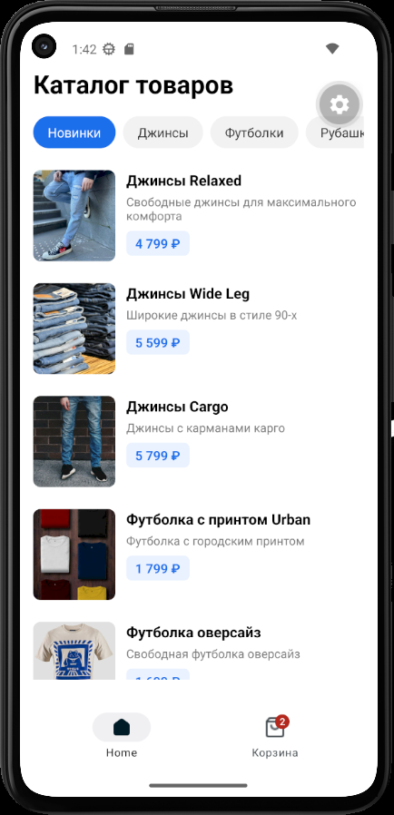
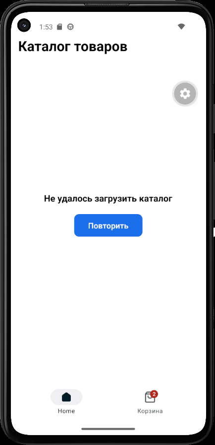
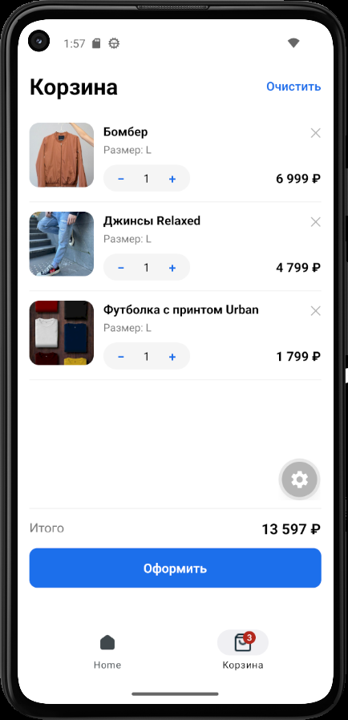
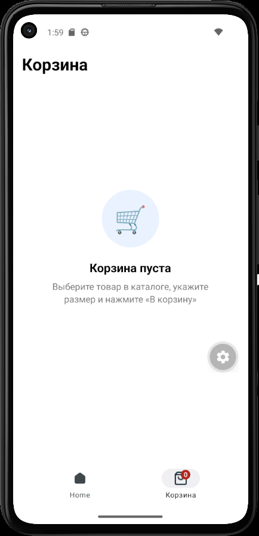

# Store App

Каталог товаров с категориями, карточка товара, корзина.

Стек: React Native + Expo (Android).

## О проекте

Мобильное приложение интернет-магазина одежды. Пользователь листает каталог по категориям, открывает карточку товара в выезжающей панели (bottom sheet), выбирает размер, добавляет товар в корзину и оформляет заказ. Корзина сохраняется на устройстве и восстанавливается после перезапуска приложения.

Каталог загружается с сервера курса. Если сервер недоступен, приложение показывает ошибку с кнопкой «Повторить».

## Команда

| Участник | Роль |
|---|---|
| Лаврик Валерий (группа Б9124-09.03.03ПИКД) | Соло-разработчик: архитектура, интерфейс, работа с API, корзина, документация |

## Возможности

- Каталог товаров с табами категорий. Первым табом всегда идёт «Новинки»: в него попадают товары с тегом `New` из всех категорий.
- Состояния каталога: загрузка, ошибка сети с повтором, пустая категория.
- Bottom sheet с деталями товара: картинка, теги поверх картинки, название, описание, выбор размера, кнопка «В корзину» с ценой.
- Кнопка (i) в карточке открывает окно с характеристиками: материал, вес, сезон, страна производства.
- Закрытие bottom sheet тремя способами: свайп вниз, крестик, тап по затемнённому фону.
- Корзина: количество «−/+», удаление позиции, очистка с подтверждением, общая стоимость, пустое состояние.
- Бейдж с количеством товаров на иконке корзины в нижнем меню.
- Локальное сохранение корзины (только id товара, id размера и количество).
- Оформление заказа: корзина очищается, показывается сообщение об успехе.

## Скриншоты

### Каталог






### Карточка товара


### Корзина







## Запуск

Понадобится:
- [Node.js](https://nodejs.org) (LTS)
- [Android Studio](https://developer.android.com/studio) с настроенным эмулятором (Device Manager → создать Virtual Device)
- Доступ в интернет (каталог и картинки товаров загружаются по сети)

Шаги:

```bash
npm install
npx expo start -c
```

Когда появится меню в терминале — нажми `a`, приложение соберётся и откроется в запущенном Android-эмуляторе.

## Структура проекта

```
store-app/
├── assets/
│   └── images/                 иконки приложения и иконки нижнего меню (tabIcons/)
├── docs/
│   └── screenshots/            скриншоты для README
├── src/
│   ├── app/                    экраны (файловая навигация Expo Router)
│   │   ├── _layout.tsx         корневой layout: провайдеры, навигатор, bottom sheet
│   │   └── tabs/
│   │       ├── _layout.tsx     тема и нижнее меню
│   │       ├── index.tsx       экран «Каталог»
│   │       └── cart.tsx        экран «Корзина»
│   ├── components/
│   │   ├── app-tabs.tsx        нижнее меню (каталог + корзина) и бейдж
│   │   └── product-sheet.tsx   bottom sheet с деталями товара
│   ├── constants/
│   │   └── api.ts              адрес API, токен, таймаут запроса
│   ├── context/
│   │   ├── catalog-context.tsx состояние каталога (данные, табы, выбранный товар)
│   │   └── cart-context.tsx    состояние корзины и сохранение на диск
│   ├── data/
│   │   └── catalog-repository.ts  запрос каталога к серверу и проверка ответа
│   ├── types/
│   │   └── product.ts          типы данных (товар, размер, категория)
│   └── utils/
│       └── format-price.ts     копейки → рубли («4 999 ₽»)
├── app.json                    настройки приложения Expo
└── package.json                зависимости и скрипты
```

## Как это работает

### Загрузка каталога

1. При запуске `CatalogProvider` вызывает `loadCatalog()` из `src/data/catalog-repository.ts`.
2. Функция делает запрос `GET /catalog` с заголовком `Authorization: Bearer <токен>`. Запрос обрывается, если сервер не отвечает 10 секунд.
3. Ответ проверяется: статус 200, корректный JSON, наличие списков `categories` и `items`. Любая ошибка превращается в понятное сообщение на русском.
4. Провайдер хранит статус (`loading` / `error` / `ready`), данные и функцию `reload()` для кнопки «Повторить».

Данные каталога лежат в провайдере над экранами, а не в самих экранах, поэтому переключение вкладок и поворот экрана их не сбрасывают.

### Каталог и категории

- Список табов собирается на клиенте: первым идёт «Новинки», далее категории с сервера.
- «Новинки» показывают товары с тегом `New` из всех категорий. Остальные табы фильтруют по `categoryId`.
- Цена приходит в копейках (`priceInKopecks`) и переводится в рубли функцией `formatPrice`.

### Bottom sheet с деталями товара

- Тап по товару вызывает `openProduct(id)`: выбранный товар хранится в `CatalogProvider`, поэтому на всё приложение существует один bottom sheet (`ProductSheet` в корневом layout).
- Панель написана на стандартных средствах React Native (`Modal` + `Animated`), свайп вниз обрабатывает `react-native-gesture-handler`.
- По умолчанию выбран первый размер товара. Кнопка «В корзину» добавляет именно выбранный размер.
- Кнопка (i) открывает окно с характеристиками прямо внутри панели.

### Корзина

- Позиция корзины — это пара «товар + размер» и количество: `{ itemId, sizeId, quantity }`. Название, цену и картинку экран берёт из каталога по id в момент показа.
- Повторное добавление того же товара с тем же размером увеличивает количество, другой размер создаёт отдельную позицию.
- Бейдж на иконке корзины показывает сумму количеств по всем позициям и скрывается, когда корзина пуста.

### Сохранение корзины

- Корзина записывается в локальное хранилище устройства (`AsyncStorage`, ключ `cart.v1`) при каждом изменении. Хранятся только `itemId`, `sizeId` и `quantity`.
- При запуске корзина читается с диска, затем сверяется с загруженным каталогом: товары и размеры, которых там больше нет, тихо удаляются.
- Пока корзина не прочитана, запись на диск заблокирована, чтобы пустой массив при старте не затёр сохранённые данные.

### Оформление заказа

Кнопка «Оформить» видна только при непустой корзине. После нажатия корзина очищается (в том числе на диске) и показывается сообщение об успешном оформлении.

## API

| Параметр | Значение |
|---|---|
| Адрес | `GET https://fefu2026spring.deploy.feip.dev/catalog` |
| Авторизация | заголовок `Authorization: Bearer <токен>` |
| Токен и адрес | `src/constants/api.ts` |
| Формат ответа | `{ categories: [{ id, name }], items: [{ id, name, shortDescription, longDescription, priceInKopecks, imageUrl, tags, sizes, categoryId, material, weight, season, countryOfOrigin }] }` |

Чтобы проверить экран ошибки, временно измените адрес в `src/constants/api.ts` на неверный или включите в эмуляторе режим полёта.

## Используемые технологии

- React Native, Expo, Expo Router (файловая навигация, нижнее меню на `NativeTabs`)
- TypeScript
- `@react-native-async-storage/async-storage` — локальное хранение корзины
- `react-native-gesture-handler` — свайп для закрытия bottom sheet
